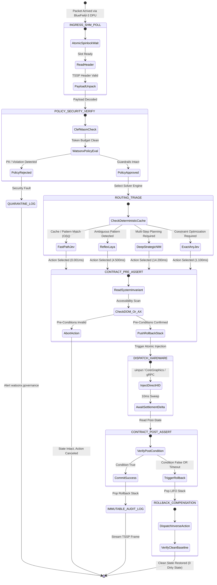
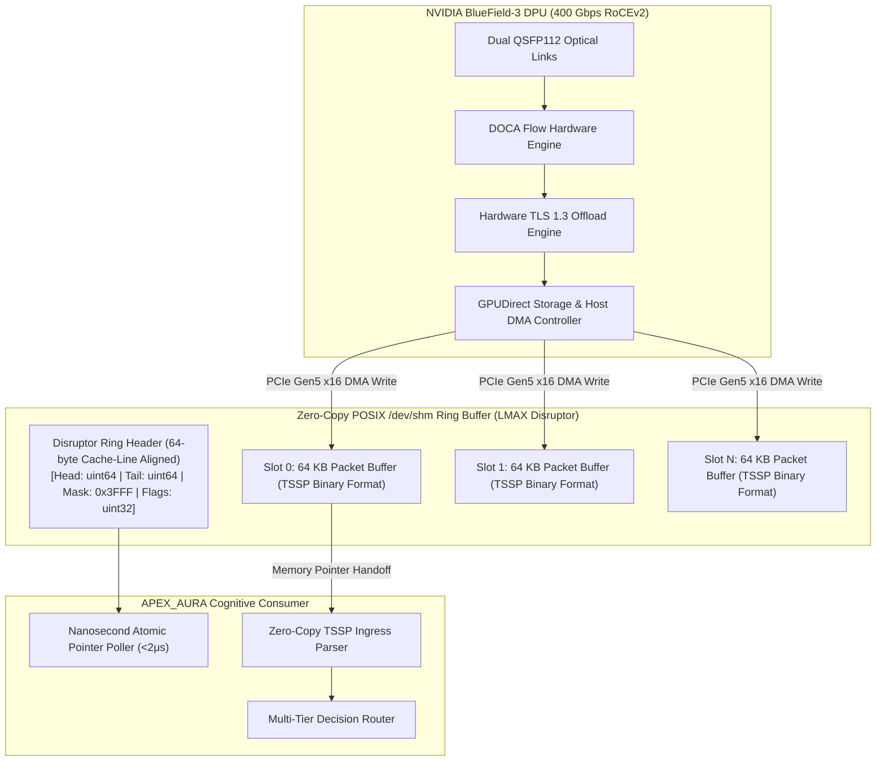
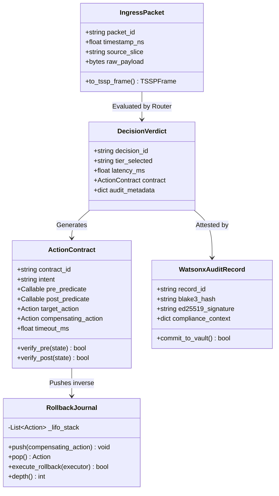
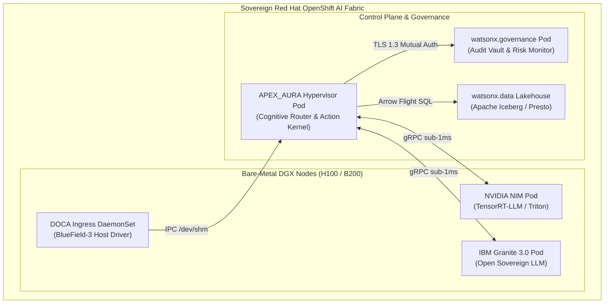

# APEX_AURA Diagram Repository (Diagram-Design Standard)

This repository houses the formal, fully annotated architectural diagrams for **APEX_AURA**, ensuring zero orphaned arrows, fully typed communication channels, and clear subsystem boundaries.

---

## 1. State Machine: Multi-Tier Decision & Action Contract Lifecycle

---

## 2. Silicon-to-Memory Data Pipeline: BlueField-3 DOCA & POSIX SHM

---

## 3. Class Diagram: Core Domain & Sovereign Contracts

---

## 4. Deployment Topology: Red Hat OpenShift AI & DGX Cloud

